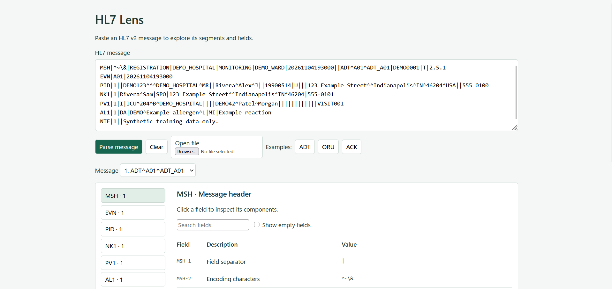

# HL7 Lens

A small HL7 v2 message explorer using plain HTML, CSS and JavaScript.
Paste a message, select a segment, then expand a field to see its components.

## Scope

Supports multiple messages and custom delimiters. Raw values are preserved. Files/text are limited to 1 MB.

This simply UI keeps file import, examples, search, an empty-field toggle,
JSON inspection and download.

This is a structural explorer, not an HL7 conformance validator or FHIR converter.
